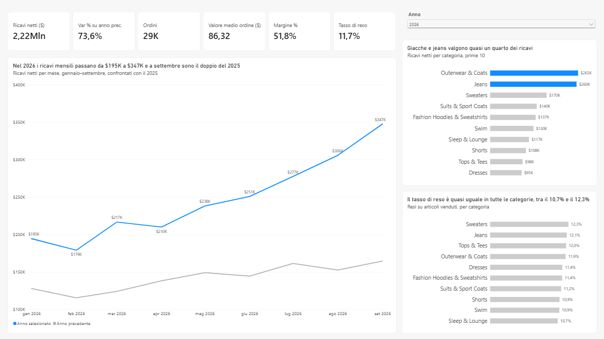
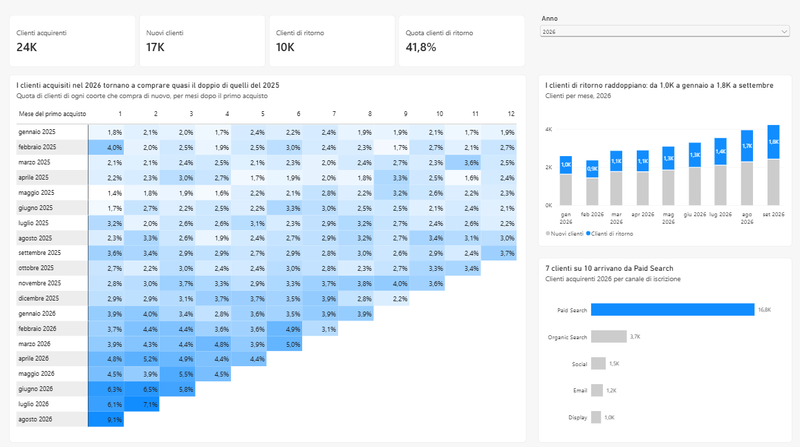
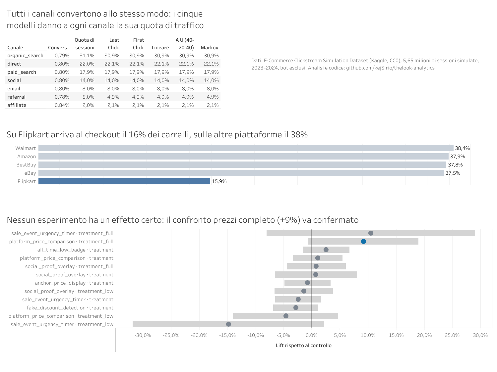

# theLook Analytics

Progetto di studio impostato come un ingaggio di consulenza: dai dati grezzi di un e-commerce a un modello a stella, metriche condivise, report Power BI e Tableau, analisi statistiche e raccomandazioni per il management. I dati sono pubblici e sintetici: i numeri mostrano il metodo, non il comportamento di un'azienda reale.

**Presentazione del progetto:** [stefanomanco.it/ds](https://stefanomanco.it/ds/)

**Stack:** BigQuery (SQL) · modello a stella · dbt e MetricFlow · Power BI e DAX · Tableau · Python (DuckDB, SciPy)

## Lo scenario

theLook è un negozio online di abbigliamento. Il management chiede risposta a cinque domande:

1. Quali canali portano clienti che tornano a comprare, e quanto vale ciascuno oltre il last click? *(attribution)*
2. Dove si perde il funnel prodotto → carrello → acquisto, e cambia per canale o browser? *(funnel)*
3. I clienti acquisiti nel 2026 tornano a comprare più o meno di quelli del 2025? *(coorti)*
4. Quali categorie pesano di più, e quali hanno più resi? *(analisi descrittiva)*
5. Quale variante di un esperimento migliora la conversione, e per chi? *(A/B test)*

## theLook: risultati (gennaio–settembre 2026)

Tutti i numeri si riferiscono alla fotografia dei dati dell'8 novembre 2026 (vedi "Dati e loro limiti").

- **Ricavi:** $2,22 milioni netti, +73,6% sullo stesso periodo del 2025. I ricavi mensili passano da $195K a gennaio a $347K a settembre, il doppio di settembre 2025.
- **Categorie:** giacche, cappotti e jeans valgono quasi un quarto dei ricavi ($525K su $2,22 milioni).
- **Resi:** 11,7% degli articoli venduti, con poche differenze tra le categorie (dal 10,7% al 12,3%).
- **Clienti:** 24.377 clienti acquirenti. Il 41,7% (10.166) ha fatto almeno un riacquisto nel periodo; 17.112 hanno fatto il primo acquisto. I due gruppi si sovrappongono: chi ha fatto il primo ordine ed è tornato rientra in entrambi.
- **Coorti:** entro 90 giorni dal primo acquisto ricompra il 12,5% dei clienti del 2026, contro il 7,6% di quelli del 2025: +4,9 punti, con intervallo di confidenza al 95% da 4,2 a 5,7. Non è un salto ma una crescita continua, di circa mezzo punto per ogni mese di coorte (R² 0,83).
- **Canali:** 7 clienti su 10 si iscrivono da Paid Search. Il canale delle visite successive non dipende da quello di iscrizione (chi-quadro p = 0,13; V di Cramér 0,006), quindi un modello di attribution non avrebbe segnale. Il valore dei clienti però si può misurare: nei primi 12 mesi un cliente vale tra $49 e $54 di margine lordo, qualunque sia il canale, senza differenze significative. I canali si scelgono quindi in base al costo, con un tetto di circa $50 per cliente.
- **Test su Paid Search:** sospenderlo nel 30% delle regioni per 6 settimane basta a vedere se porta almeno il 46% delle vendite che gli si attribuiscono. Nel caso peggiore il test costa l'1,45% dei ricavi di un anno.
- **Coerenza:** il progetto dbt supera tutti i 54 test, e MetricFlow e Power BI danno gli stessi numeri. I ricavi netti coincidono al centesimo con il totale di controllo della fotografia ($2.219.620,07).

### Vendite



### Clienti



## Funnel, attribution e A/B test (marketplace simulati, 2023–2024)

theLook non ha esperimenti e il suo funnel segue regole fisse, quindi le domande 1, 2 e 5 sono analizzate su un secondo dataset: 5,65 milioni di sessioni su cinque marketplace, esclusi i bot.

- **Funnel:** su 100 sessioni, 3,2 arrivano al carrello, 1,1 al checkout e 0,8 all'acquisto. Canale, browser e dispositivo non cambiano nulla. Su Flipkart, però, arriva al checkout il 15,9% dei carrelli, contro il 37,9% delle altre piattaforme, su ogni dispositivo, canale, paese e trimestre. Allineato alle altre piattaforme, varrebbe circa $425.000 di ricavi in più l'anno.
- **Attribution:** ogni utente arriva sempre dallo stesso canale e la conversione è uguale per tutti i canali. I cinque modelli, Markov compreso, coincidono con la quota di traffico: come in theLook, non c'è un segnale da attribuire.
- **A/B test, i risultati:** nessuno dei 6 esperimenti ha un effetto certo dopo la correzione per i confronti multipli. Con circa 50.000 utenti per gruppo i test vedevano solo effetti dal 6% in su. Il disegno è corretto: assegnazione per utente, gruppi bilanciati, nessuna differenza tra segmenti e nessun effetto novità.
- **A/B test, le decisioni:**
  - il confronto prezzi completo ha il 97% di probabilità di migliorare la conversione e una perdita attesa dello 0,05%: si può lanciare in modo graduale, aspettandosi però un guadagno piccolo, perché la meta-analisi ridimensiona il +9,2% osservato a circa +0,4%;
  - in tutti e tre gli esperimenti con due versioni, la completa converte più della leggera (+0,4 punti insieme, p = 0,048): le versioni leggere non servono;
  - con questa base utenti si possono testare solo modifiche da +5% in su, che richiedono il 28% degli utenti; per vedere un +3% ne servirebbe il 77%.
- **Una variabile esclusa:** il "segmento di valore" del dataset converte al 100% o allo 0%, perché è costruito sugli acquisti. Usarlo per dividere un test ne falserebbe il risultato.

### Dashboard Tableau Public

[Apri la dashboard interattiva](https://public.tableau.com/views/Funneledesperimenti/Dashboard1): passando il mouse sugli esperimenti si leggono lift, intervallo di confidenza, probabilità bayesiana e decisione.



## Per il management

- [`docs/readout.pdf`](docs/readout.pdf): readout di 10 slide con sintesi, risultati e azioni in ordine di valore.
- [`docs/memo.md`](docs/memo.md): vendite, clienti e canali di theLook, tre raccomandazioni.
- [`docs/memo_esperimenti.md`](docs/memo_esperimenti.md): funnel ed esperimenti sui marketplace, quattro raccomandazioni.

## Dati e loro limiti

- **Fonte principale:** `bigquery-public-data.thelook_ecommerce`, dataset pubblico di Google su BigQuery: utenti, ordini, righe d'ordine, prodotti, magazzino ed eventi web, da febbraio 2019.
- **Funnel, attribution e A/B test:** [E-Commerce Clickstream Simulation Dataset](https://www.kaggle.com/datasets/amith1707/e-commerce-clickstream-simulation-dataset) su Kaggle, licenza CC0: 5,77 milioni di sessioni simulate su cinque marketplace, 2023–2024, con 6 esperimenti. Si scarica e si interroga con DuckDB dentro Colab, senza passare da BigQuery. La documentazione non coincide del tutto con i dati (conversione 0,78% contro lo 0,9% dichiarato, 11 paesi invece di 10, due segnali sempre falsi): valgono i dati. Le 121.242 sessioni segnalate come bot sono escluse.
- **Dati sintetici:** i risultati mostrano il metodo, non il comportamento di un'azienda reale.
- **Fotografia dei dati.** Il dataset pubblico viene rigenerato: tra il 7 e l'8 novembre 2026 i ricavi netti di gennaio–settembre 2026 sono passati da $2,20 a $2,22 milioni, con la data di taglio invariata. La differenza è emersa confrontando Power BI e MetricFlow. Per questo il progetto lavora su una copia fissa (`sql/00_fotografia_dati.sql`, dataset `raw`), e i numeri di theLook in questo README si riferiscono a quella copia. La sua carta d'identità, per riconoscerla:

  | Data | orders | order_items | users | products | events | Ricavi netti gen–set 2026 |
  | --- | --- | --- | --- | --- | --- | --- |
  | 8 novembre 2026 | 125.136 | 181.610 | 100.000 | 29.120 | 2.430.986 | $2.219.620,07 |

- **Data di taglio: 30 settembre 2026.** Il controllo settimanale dei ricavi ha trovato dati recenti gonfiati dal generatore: la settimana dal 26 ottobre segna +29% sulla precedente, e la prima di novembre più del doppio di una settimana normale in soli 6 giorni. Ottobre quindi non è un mese affidabile.
- **Cosa decide il generatore**, verificato in fase di esplorazione:
  - il canale di ogni sessione è indipendente da quello di iscrizione;
  - il funnel segue regole fisse: le sessioni anonime non comprano mai, quelle registrate quasi sempre;
  - viene creata una sessione d'acquisto per ogni riga d'ordine.

  Per questo funnel e attribution non si fanno su theLook. Anche la crescita dei ricavi e il miglioramento delle coorti recenti potrebbero dipendere dal generatore più che dal comportamento dei clienti.

## Definizioni condivise

| Metrica | Definizione |
| --- | --- |
| Ricavi lordi | Vendite esclusi gli articoli cancellati |
| Ricavi netti | Vendite esclusi gli articoli cancellati e resi |
| Ordini | Ordini non cancellati |
| Coorte | Mese del primo ordine non cancellato |
| Retention % | Clienti della coorte che comprano in un dato mese, sul totale della coorte |

Le stesse definizioni sono in `sql/02_marts.sql`, nelle misure DAX (`powerbi/misure_tutte.dax`) e nelle metriche MetricFlow (`dbt/models/semantic/metrics.yml`).

## Stato

- [x] Esplorazione dei dati (`sql/00_esplorazione.sql`)
- [x] Modello a stella: staging e mart (`sql/01_staging.sql`, `sql/02_marts.sql`)
- [x] Report Power BI con 17 misure DAX e matrice delle coorti
- [x] Test statistici su coorti e canali (`notebooks/01_coorti_e_canali.ipynb`)
- [x] Progetto dbt con 54 test, controllo anomalie e semantic layer MetricFlow (`dbt/`, `notebooks/02_dbt_metricflow.ipynb`)
- [x] Funnel, attribution e A/B test, con meta-analisi e regola di decisione (`notebooks/03_ab_test_e_funnel.ipynb`)
- [x] Valore del cliente per canale e disegno del test geografico (`notebooks/04_valore_canali_e_test_geografico.ipynb`)
- [x] Dashboard Tableau Public ([link](https://public.tableau.com/views/Funneledesperimenti/Dashboard1), dati in `tableau/`)
- [x] Memo, readout per il management e guida al modello (`docs/`)

## Struttura

```
sql/          esplorazione, fotografia dei dati, staging e mart come script BigQuery
dbt/          gli stessi staging e mart come progetto dbt: test, controllo anomalie, semantic layer MetricFlow
powerbi/      report Power BI, misure DAX, guida alle misure, screenshot
tableau/      dati aggregati e immagine della dashboard Tableau Public
notebooks/    01 coorti e canali, 02 dbt e MetricFlow, 03 funnel, attribution e A/B test,
              04 valore dei canali e test geografico (Google Colab)
docs/         readout in PDF, due memo, guida al modello per chi entra nel progetto
```

## Autore

Stefano Manco · [stefanomanco.it](https://stefanomanco.it)
